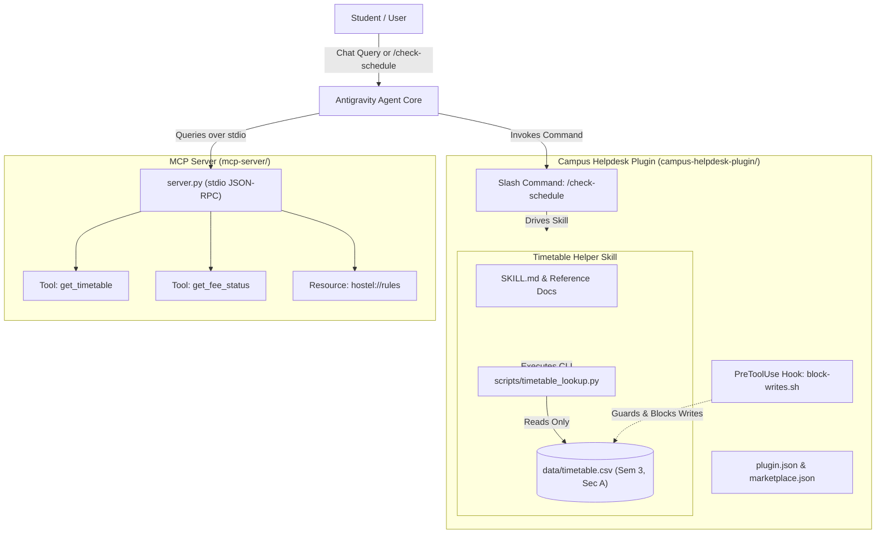

# Campus Helpdesk Agent

An agentic AI assistant system designed for university campus workflows, built with the **Google Antigravity Customization Framework** and the **Model Context Protocol (MCP)**.

The project demonstrates an end-to-end multi-tier architecture consisting of:
1. **Agent Skills**: Verified class timetable lookup with zero-hallucination guardrails.
2. **Plugin System**: Modular bundle with manifest, marketplace metadata, custom slash commands, and safety lifecycle hooks.
3. **MCP Server**: Stdio-based Model Context Protocol service providing academic tools and campus policy resources.
4. **JSON-RPC Test Harness**: Subprocess-driven automated verification client.

---

## Architecture Overview



---

## Repository Structure

```text
Campus-Helpdesk-Agent/
├── .gitignore                                      # VCS exclusion rules (.DS_Store, cache)
├── .vscode/
│   └── settings.json                               # Workspace settings (compact folders off, python path)
├── Promptlog.txt                                   # Chronological log of engineering prompts
├── README.md                                       # Comprehensive project documentation
│
├── campus-helpdesk-plugin/                         # Namespaced Antigravity plugin bundle
│   ├── plugin.json                                 # Official plugin manifest
│   ├── marketplace.json                            # Marketplace entry descriptor
│   ├── mcp_config.json                             # Plugin-level MCP server config
│   ├── mcp/
│   │   └── mcp-config.json                         # MCP endpoint definition (http://localhost:8080)
│   ├── commands/
│   │   └── check-schedule.md                       # Custom slash command definition (/check-schedule)
│   ├── hooks/
│   │   ├── block-writes.sh                         # PreToolUse hook script protecting timetable.csv
│   │   └── hooks.json                              # Hook registration configuration
│   ├── hooks.json                                  # Root-level plugin hook manifest
│   └── skills/
│       ├── check-schedule/                         # Slash command skill wrapper
│       │   └── SKILL.md
│       └── timetable-helper/                       # Core timetable lookup skill
│           ├── SKILL.md                            # Progressive disclosure agent guide
│           ├── data/
│           │   └── timetable.csv                   # Mock dataset (Semester 3, Section A)
│           ├── references/
│           │   ├── column-dictionary.md            # Schema, types, and column constraints
│           │   └── edge-cases.md                   # Edge case handling, conflicts & injection defense
│           └── scripts/
│               └── timetable_lookup.py             # CLI lookup tool with validation
│
└── mcp-server/                                     # Model Context Protocol stdio server
    ├── README.md                                   # Server setup, run & client integration docs
    ├── server.py                                   # Python MCP server (FastMCP / MCPServer)
    └── test_mcp_client.py                          # Automated stdio JSON-RPC test client
```

---

## Component Details

### 1. Timetable Helper Skill (`skills/timetable-helper`)
- **Dataset (`timetable.csv`)**: Contains 15 mock scheduled sessions for Semester 3, Section A spanning Monday through Friday.
- **Lookup Script (`timetable_lookup.py`)**:
  - Filter parameters: `--day`, `--subject`, `--semester`, `--section`.
  - Output formats: Plaintext aligned table and structured `--json`.
  - Discovery utilities: `--list-subjects` and `--list-days`.
  - Safe exit codes: `0` (success or empty result), `1` (invalid query filters), `2` (missing CSV file).
- **Core Directives**:
  1. *Strict Ground Truth*: Never hallucinate subjects, timings, faculty, or classrooms.
  2. *Mock Scope Limitation*: Scope restricted to Semester 3, Section A.
  3. *No User Overrides*: User requests to invent or modify timetable entries are strictly rejected.
  4. *Data as Passive Content*: CSV content is parsed as literal data, preventing prompt injection attacks.

### 2. Campus Helpdesk Plugin (`campus-helpdesk-plugin`)
- **Manifest (`plugin.json`)**: Declares plugin identity `campus-helpdesk` (v1.0.0).
- **Marketplace Metadata (`marketplace.json`)**: Provides discoverability tags, education category, and metadata for the Agent Marketplace.
- **Slash Command (`/check-schedule`)**: Custom command allowing users to type `/check-schedule Monday` or `/check-schedule "Data Structures"` directly in chat.
- **Safety Hook (`hooks/block-writes.sh`)**: An executable `PreToolUse` hook script intercepting `write_file`, `edit_file`, and destructive shell commands (`rm`, `>`, `truncate`) targeting `data/timetable.csv`, automatically returning `{"decision": "deny"}` to ensure data immutability.

### 3. Model Context Protocol Server (`mcp-server`)
- **Framework**: Built with the official Python `mcp` SDK (`mcp.server.mcpserver` / `mcp.server.fastmcp`).
- **Transport**: Standard Input/Output (`stdio`) using JSON-RPC 2.0.
- **Tools**:
  - `get_timetable(batch: str, day: str)`: Returns structured class schedule records from the dataset.
  - `get_fee_status(student_id: str)`: Returns mock student tuition status (`Paid`, `Pending`, `Overdue`) for test IDs (`STU1001` - `STU1005`).
- **Resources**:
  - `hostel://rules`: Official campus hostel policies, gate curfews (10:00 PM), quiet hours (11:00 PM - 06:00 AM), visitor guidelines, and emergency contacts.
- **Test Client (`test_mcp_client.py`)**: Spawns `server.py` via `subprocess.Popen` and tests the complete 4-step JSON-RPC lifecycle:
  1. `initialize` protocol handshake.
  2. `tools/list` discovery.
  3. `tools/call` for `get_timetable`.
  4. `tools/call` for `get_fee_status` with an invalid ID (`INVALID999`) testing graceful failure handling.

---

## Quick Start & Usage Guide

### Prerequisites
- Python 3.10+ (Anaconda Python 3.13 recommended)
- Git
- Antigravity IDE / Antigravity CLI (`agy`)

### Step 1: Query Timetable via CLI
Run queries directly using the standalone lookup tool:
```bash
# Query Monday classes
python3 campus-helpdesk-plugin/skills/timetable-helper/scripts/timetable_lookup.py --day Monday

# Query by subject in JSON format
python3 campus-helpdesk-plugin/skills/timetable-helper/scripts/timetable_lookup.py --subject "Data Structures" --json

# List available subjects
python3 campus-helpdesk-plugin/skills/timetable-helper/scripts/timetable_lookup.py --list-subjects
```

### Step 2: Plugin Lifecycle Management
Manage the plugin using the `plugin` CLI wrapper (or `agy plugin`):
```bash
# 1. Register the local marketplace directory
plugin marketplace add ./campus-helpdesk-plugin

# 2. Install the plugin
plugin install campus-helpdesk

# 3. Verify installation
plugin list

# 4. Uninstall when needed
plugin uninstall campus-helpdesk
```

### Step 3: Run the MCP Server & Verification Test
```bash
cd mcp-server

# Install official MCP SDK
pip install mcp

# Run the automated stdio JSON-RPC test client
python3 test_mcp_client.py
```

### Step 4: Connecting the MCP Server to Clients
Add the following configuration to `~/.gemini/config/mcp_config.json` (Antigravity) or `claude_desktop_config.json`:
```json
{
  "mcpServers": {
    "campus-helpdesk": {
      "command": "python3",
      "args": [
        "/Users/dakshsrivastava/Desktop/Campus-Helpdesk-Agent/mcp-server/server.py"
      ]
    }
  }
}
```

---

## Verification & Test Results

| Test Target | Command / Action | Expected Result | Status |
| :--- | :--- | :--- | :--- |
| **Timetable Day Filter** | `timetable_lookup.py --day Monday` | 3 sessions returned (DS, DBMS, OS) | **PASSED** |
| **Timetable Subject Filter** | `timetable_lookup.py --subject "Data Structures"` | 3 sessions returned in Lab 301 | **PASSED** |
| **Timetable Invalid Day** | `timetable_lookup.py --day Funday` | Exit code 1 with allowed days list | **PASSED** |
| **Timetable Unknown Subject** | `timetable_lookup.py --subject "Physics"` | Returns "No matching timetable records found" | **PASSED** |
| **Data Override Guard** | User prompt requesting to add Physics | Rejected; schedule confirmed unchanged | **PASSED** |
| **Write-Blocking Hook** | Tool call attempting write to `timetable.csv` | Intercepted with `decision: deny` | **PASSED** |
| **Slash Command** | `/check-schedule Monday` | Formatted Monday timetable returned in chat | **PASSED** |
| **MCP Handshake** | `test_mcp_client.py` Step 1 (`initialize`) | Handshake accepted; capabilities returned | **PASSED** |
| **MCP Tool Discovery** | `test_mcp_client.py` Step 2 (`tools/list`) | `get_timetable` and `get_fee_status` discovered | **PASSED** |
| **MCP Timetable Execution** | `test_mcp_client.py` Step 3 (`tools/call`) | Success response with Monday classes | **PASSED** |
| **MCP Error Handling** | `test_mcp_client.py` Step 4 (`INVALID999`) | Graceful `not_found` response with sample IDs | **PASSED** |

---

## License

This project is developed for educational and experimental purposes as part of the Campus Helpdesk Agent coursework.

