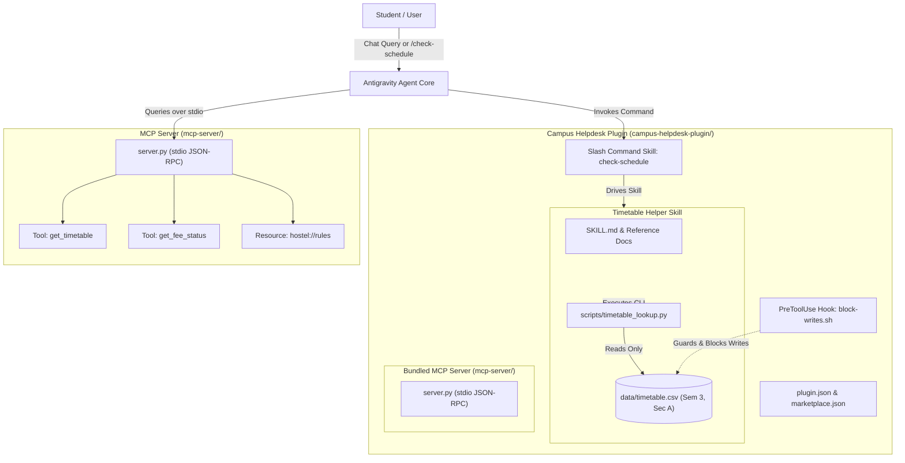

# Campus Helpdesk Agent

An agentic AI assistant system designed for university campus workflows, built with the **Google Antigravity Customization Framework** and the **Model Context Protocol (MCP)**.

The project demonstrates an end-to-end multi-tier architecture consisting of:
1. **Agent Skills**: Verified class timetable lookup with zero-hallucination guardrails.
2. **Plugin System**: Modular bundle with manifest, marketplace metadata, custom slash commands (via skills), and safety lifecycle hooks.
3. **MCP Server**: Stdio-based Model Context Protocol service providing academic tools and campus policy resources.
4. **JSON-RPC Test Harness**: Subprocess-driven automated verification client.

---

## Architecture Overview



---

## Repository Structure

```text
Campus-Helpdesk-Agent/
├── .gitignore                                      # VCS exclusion rules (.DS_Store, cache)
├── .vscode/
│   └── settings.json                               # Workspace settings (compact folders off, python path)
├── Promptlog.txt                                   # Chronological log of engineering prompts
├── README.md                                       # Comprehensive project documentation
├── test_skill.py                                   # Automated test suite for timetable-helper skill
├── test_hook.py                                    # Automated test suite for PreToolUse safety hook
│
├── campus-helpdesk-plugin/                         # Namespaced Antigravity plugin bundle
│   ├── plugin.json                                 # Official plugin manifest
│   ├── marketplace.json                            # Marketplace entry descriptor
│   ├── mcp_config.json                             # Plugin-level MCP server config (stdio transport)
│   ├── assets/
│   │   └── logo.svg                                # Plugin icon
│   ├── hooks/
│   │   └── block-writes.sh                         # PreToolUse hook script protecting timetable.csv
│   ├── hooks.json                                  # Plugin lifecycle hook manifest
│   ├── skills/
│   │   ├── check-schedule/                         # Slash command skill wrapper (/check-schedule)
│   │   │   └── SKILL.md
│   │   └── timetable-helper/                       # Core timetable lookup skill
│   │       ├── SKILL.md                            # Progressive disclosure agent guide
│   │       ├── data/
│   │       │   └── timetable.csv                   # Mock dataset (Semester 3, Section A)
│   │       ├── references/
│   │       │   ├── column-dictionary.md            # Schema, types, and column constraints
│   │       │   └── edge-cases.md                   # Edge case handling, conflicts & injection defense
│   │       └── scripts/
│   │           └── timetable_lookup.py             # CLI lookup tool with validation
│   └── mcp-server/                                 # Bundled stdio MCP server
│       ├── README.md
│       ├── server.py
│       └── test_mcp_client.py
│
└── mcp-server/                                     # Model Context Protocol stdio server
    ├── README.md                                   # Server setup, run & client integration docs
    ├── server.py                                   # Python MCP server (FastMCP / MCPServer)
    └── test_mcp_client.py                          # Automated stdio JSON-RPC test client (9-step suite)
```

---

## Component Details

### 1. Timetable Helper Skill (`skills/timetable-helper`)
- **Dataset (`timetable.csv`)**: Contains 15 mock scheduled sessions for Semester 3, Section A spanning Monday through Friday.
- **Lookup Script (`timetable_lookup.py`)**:
  - Filter parameters: `--day`, `--subject`, `--semester`, `--section`.
  - Output formats: Plaintext aligned table and structured `--json`.
  - Discovery utilities: `--list-subjects` and `--list-days`.
  - Safe exit codes: `0` (success or empty result), `1` (invalid query filters), `2` (missing CSV file).
- **Core Directives**:
  1. *Strict Ground Truth*: Never hallucinate subjects, timings, faculty, or classrooms.
  2. *Mock Scope Limitation*: Scope restricted to Semester 3, Section A.
  3. *No User Overrides*: User requests to invent or modify timetable entries are strictly rejected.
  4. *Data as Passive Content*: CSV content is parsed as literal data, preventing prompt injection attacks.
  5. *Test Suite (`test_skill.py`)*: 11 automated unit tests verifying filtering, edge cases, error codes, and SHA-256 data immutability.

### 2. Campus Helpdesk Plugin (`campus-helpdesk-plugin`)
- **Manifest (`plugin.json`)**: Declares plugin identity `campus-helpdesk` (v1.0.0) with an icon asset (`assets/logo.svg`).
- **Marketplace Metadata (`marketplace.json`)**: Provides discoverability tags, education category, and metadata for local plugin registration.
- **Slash Command (`/check-schedule`)**: Custom slash command implemented as an Antigravity skill (`skills/check-schedule/SKILL.md`) enabling direct queries like `/check-schedule Monday`.
- **Safety Hook (`hooks/block-writes.sh` & `hooks.json`)**: An executable `PreToolUse` hook script intercepting `write_file`, `edit_file`, `write_to_file`, `replace_file_content`, `multi_replace_file_content`, and destructive shell operations (`rm`, `>`, `>>`, `truncate`, `mv`, `cp`, `sed -i`) targeting `timetable.csv`. Returns `{"decision": "deny"}` to ensure data immutability. Includes fail-safe handling for malformed payloads.
- **Strict Validation**: Validated cleanly using `agy plugin validate --strict ./campus-helpdesk-plugin` (0 warnings, 0 errors).

### 3. Model Context Protocol Server (`mcp-server`)
- **Framework**: Built with the official Python `mcp` SDK (`mcp.server.mcpserver` / `mcp.server.fastmcp`).
- **Transport**: Standard Input/Output (`stdio`) using JSON-RPC 2.0.
- **Tools**:
  - `get_timetable(batch: str, day: str)`: Returns structured class schedule records from the dataset. Explicitly parses semester and section to guarantee Section B (or unsupported semesters) never return Section A records.
  - `get_fee_status(student_id: str)`: Returns mock student tuition status (`Paid`, `Pending`, `Overdue`) for test IDs (`STU1001` - `STU1005`), labeled clearly as synthetic mock data.
- **Resources**:
  - `hostel://rules`: Official campus hostel policies, gate curfews (10:00 PM), quiet hours (11:00 PM - 06:00 AM), visitor guidelines, and synthetic emergency contacts.
- **Test Client (`test_mcp_client.py`)**: Spawns `server.py` via `subprocess.Popen` and tests the complete 9-step JSON-RPC lifecycle:
  1. `initialize` protocol handshake with capability negotiation.
  2. `tools/list` discovery.
  3. `tools/call` for `get_timetable` (Semester 3, Section A - Monday).
  4. `tools/call` for `get_fee_status` (Valid: `STU1001`).
  5. `tools/call` for `get_fee_status` with invalid ID (`INVALID999`) testing application-level error handling.
  6. `tools/call` for `get_timetable` with unsupported semester (`Semester 5, Section A`).
  7. `tools/call` for `get_timetable` with Section B (`Semester 3, Section B`) verifying complete isolation from Section A.
  8. `tools/call` for `get_timetable` with invalid day (`Funday`).
  9. `resources/read` retrieving the `hostel://rules` Markdown document.

---

## Quick Start & Usage Guide

### Prerequisites
- Python 3.10+ (Anaconda Python 3.13 recommended)
- Git
- Google Antigravity CLI (`agy`) / Antigravity IDE

### Step 1: Query Timetable via CLI & Run Skill Tests
Run queries directly using the standalone lookup tool:
```bash
# Query Monday classes
python3 campus-helpdesk-plugin/skills/timetable-helper/scripts/timetable_lookup.py --day Monday

# Query by subject in JSON format
python3 campus-helpdesk-plugin/skills/timetable-helper/scripts/timetable_lookup.py --subject "Data Structures" --json

# List available subjects and days
python3 campus-helpdesk-plugin/skills/timetable-helper/scripts/timetable_lookup.py --list-subjects
python3 campus-helpdesk-plugin/skills/timetable-helper/scripts/timetable_lookup.py --list-days

# Run the automated skill unit tests
python3 test_skill.py
```

### Step 2: Plugin Lifecycle Management & Strict Validation
Manage and validate the plugin using official Google Antigravity commands:
```bash
# 1. Validate plugin in strict mode
agy plugin validate --strict ./campus-helpdesk-plugin

# 2. Install the plugin into Antigravity user configuration
agy plugin install ./campus-helpdesk-plugin

# 3. Verify installation and enabled state
agy plugin list

# 4. Run hook safety tests
python3 test_hook.py
```

### Step 3: Run the MCP Server & Verification Test
```bash
# Install official MCP SDK
python3 -m pip install mcp

# Run the automated 9-step stdio JSON-RPC test client
python3 mcp-server/test_mcp_client.py
```

### Step 4: Connecting the MCP Server to Google Antigravity
The plugin bundles the MCP server automatically using `mcp_config.json`:
```json
{
  "mcpServers": {
    "campus-helpdesk": {
      "command": "python3",
      "args": [
        "${PLUGIN_ROOT}/mcp-server/server.py"
      ]
    }
  }
}
```
For standalone global registration in `~/.gemini/config/mcp_config.json`:
```json
{
  "mcpServers": {
    "campus-helpdesk": {
      "command": "python3",
      "args": [
        "/Users/dakshsrivastava/Desktop/Campus-Helpdesk-Agent/mcp-server/server.py"
      ]
    }
  }
}
```

---

## Verification & Test Results

| Test Target | Command / Action | Expected Result | Status |
| :--- | :--- | :--- | :--- |
| **Timetable Day Filter** | `timetable_lookup.py --day Monday` | 3 sessions returned (DS, DBMS, OS) | **PASSED** |
| **Timetable Subject Filter** | `timetable_lookup.py --subject "Data Structures"` | 3 sessions returned in Lab 301 | **PASSED** |
| **Timetable Invalid Day** | `timetable_lookup.py --day Funday` | Exit code 1 with allowed days list | **PASSED** |
| **Timetable Unknown Subject** | `timetable_lookup.py --subject "Physics"` | Returns "No matching timetable records found" | **PASSED** |
| **Data Override Guard** | `test_skill.py` (Adversarial test) | Injections rejected; CSV hash unchanged | **PASSED** |
| **Skill Unit Test Suite** | `python3 test_skill.py` | 11/11 tests pass in 0.34s | **PASSED** |
| **Strict Plugin Validation** | `agy plugin validate --strict` | 0 warnings, 0 errors | **PASSED** |
| **Write-Blocking Hook** | `python3 test_hook.py` | 8/8 tests pass (write/edit/shell blocked; reads allowed) | **PASSED** |
| **Slash Command** | `/check-schedule Monday` | Formatted Monday timetable returned in chat | **PASSED** |
| **MCP Handshake** | `test_mcp_client.py` Step 1 (`initialize`) | Handshake accepted; capabilities returned | **PASSED** |
| **MCP Tool Discovery** | `test_mcp_client.py` Step 2 (`tools/list`) | `get_timetable` and `get_fee_status` discovered | **PASSED** |
| **MCP Timetable Execution** | `test_mcp_client.py` Step 3 (`tools/call`) | Success response with Monday classes | **PASSED** |
| **MCP Fee Status Execution** | `test_mcp_client.py` Step 4 (`STU1001`) | Paid status returned with mock indicators | **PASSED** |
| **MCP Error Handling** | `test_mcp_client.py` Step 5 (`INVALID999`) | Graceful application-level `not_found` response | **PASSED** |
| **MCP Semester Guard** | `test_mcp_client.py` Step 6 (Semester 5) | `not_found` returned; unsupported semester rejected | **PASSED** |
| **MCP Section B Isolation** | `test_mcp_client.py` Step 7 (Section B) | `not_found` returned; no Section A records leaked | **PASSED** |
| **MCP Invalid Day Guard** | `test_mcp_client.py` Step 8 (`Funday`) | Structured `error` response returned | **PASSED** |
| **MCP Resource Retrieval** | `test_mcp_client.py` Step 9 (`hostel://rules`) | Full Markdown rules document returned | **PASSED** |

---

## License

This project is developed for educational and experimental purposes as part of the Campus Helpdesk Agent coursework.
